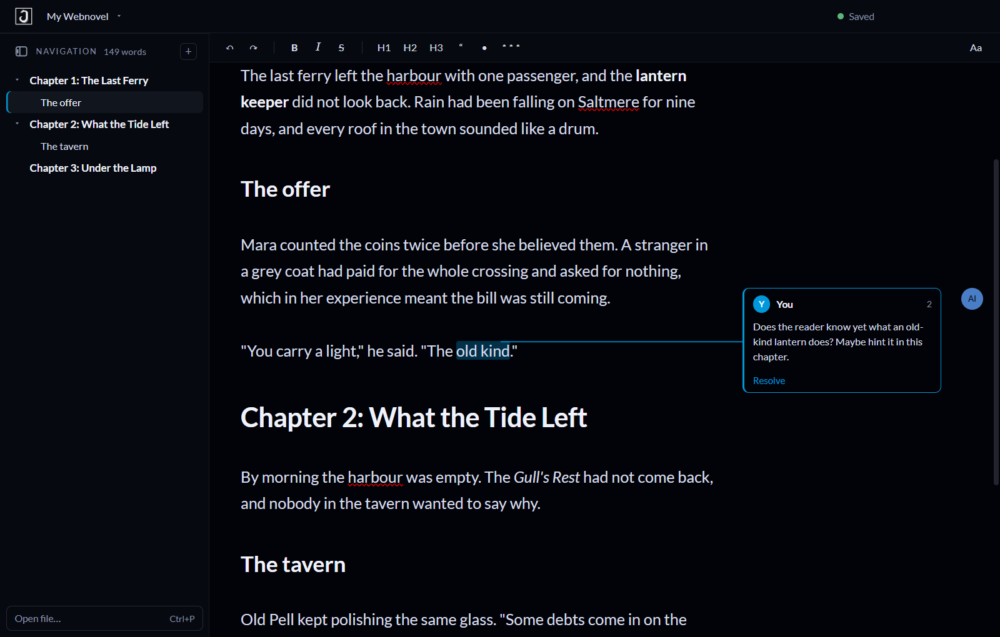

# Jormun Writer

**A distraction-free writing app for web novel authors, where an AI can edit your manuscript while you keep writing, and you decide what stays.**

[](https://ko-fi.com/boredjun)
[](LICENSE)



Writing a serial means hundreds of chapters, constant continuity checks and an AI assistant you may or may not trust.
Jormun Writer keeps the whole book in one plain **Markdown** file and shows it the way you want to read it (bold looks
bold, headings look like headings, no `**` or `#` clutter). An AI such as Claude Code edits the *same file* in VS Code; each
change appears in the app as a **keep / undo** diff, and your own typing is never overwritten.

## Why web novel writers like it

- **Your book is one document.** Chapters are headings. A Word-style **Navigation pane** lists every chapter and scene; click
  to jump, fold what you are not working on, reorder or delete a section from the right-click menu.
- **Notes in the margin, like Word comments.** Select a passage, right-click, add a note. The AI leaves its questions
  and suggestions the same way (marked **AI**) instead of rewriting your prose. You resolve them when you are done.
- **Rewrite ideas, never rewrites.** When a paragraph could be stronger, the AI shows a proposed rewrite in yellow right under it. You read it, rewrite the paragraph your own way, and dismiss it with one click. It never touches your text and is never counted or exported.
- **Review changes one by one.** An AI edit comes with Keep and Undo for each change (or Keep all), so you can take the good ones and drop the rest.
- **Version history.** The app keeps earlier versions of every file and always saves one before and after an outside edit. Restore any of them, even a file that was deleted (`Ctrl+Shift+H`).
- **Find and replace** in the chapter (`Ctrl+F`) and across the whole project (`Ctrl+Shift+F`), handy when a character is renamed.
- **A Notes list** like Word's Review pane: filter by who wrote the note, see which ones wait for your answer, resolve one or many.
- **Hide the notes and yellow ideas** with one click while you draft, and bring them back when you revise.
- **Offline grammar suggestions** (soft blue underlines, powered by [Harper](https://writewithharper.com)): right-click to fix or ignore. Spelling stays with the built-in spell checker. Nothing leaves your computer.
- **Peek at a character card** without leaving the page: right-click a name, or Alt+click it.
- **The AI proposes, you decide.** Every outside edit is a diff you can keep or undo. If you are typing in the same
  place, the app asks which version to keep and nothing is lost.
- **Live word count** at the bottom right ("2 of 149 words" while you have text selected), a clean dark interface, and fonts, size, line spacing and page width you can set.
- **Plain files, no lock-in.** Your characters, world notes and plot live in ordinary `.md` files next to the manuscript, so
  the AI can read them to keep continuity, and git, Obsidian or any editor can open them too.
- **Export to Word (.docx) or Markdown**, with your notes as real Word comments if you want them, ready to paste into your
  publishing platform.
- **Works offline.** Nothing is uploaded and the app does not phone home. It goes online only when you click *Check for updates* (it asks GitHub for the newest release number) or *Support on Ko-fi* (opens your browser).

> Early version, built for Windows and used for a real web novel. Bug reports and ideas are welcome as GitHub issues.

## Support

If Jormun Writer helps you write, you can support its development on **[Ko-fi](https://ko-fi.com/boredjun)**. Thank you!

## Install (Windows)

Download `Jormun Writer Setup 0.2.0.exe` from the [latest release](https://github.com/boreddaoist/jormun-writer/releases/latest), or build it yourself with `npm run dist`: `release/Jormun Writer Setup <version>.exe` (about 90 MB). It installs per user,
lets you choose the folder, and adds a Start menu entry and a desktop shortcut. The installer is not code-signed, so
Windows SmartScreen may say "unknown publisher": choose *More info → Run anyway*.

## Run from source

You need [Node.js](https://nodejs.org) 18 or newer (for both the installer build and running from source).

```
git clone https://github.com/boreddaoist/jormun-writer.git
cd jormun-writer
npm install
npm run dev
```

On Windows you can then start it by double-clicking `Jormun Writer.bat` (it opens the last project), or run
`npm run dev`. Set `JORMUN_PROJECT` or pass `-- --project <folder>` to choose a folder.

If Electron won't start from a VS Code terminal, run `set ELECTRON_RUN_AS_NODE=` first (VS Code sets it; the
`.bat` file already clears it).

## The window

- **Custom title bar:** the app's own bar is the top of the window (drag it to move the window; Windows draws only
  the minimise / maximise / close buttons on the right). Left to right: sidebar toggle, logo, the **project menu**
  (the project's name with a ▾), then the **save status** and the review counter.
- **Save status** (title bar, always visible): `● Saved` (green), `Saving…`, `● Unsaved` (amber, saves by itself a
  moment after you stop typing), `Save failed`, or `Needs your decision` (a file changed in two places). Click it, or press
  `Ctrl+S`, to save now. Edits made in VS Code sync in automatically; **Reload from disk** in the project menu forces a re-read.
- **Project menu** (click the logo): *Save* (`Ctrl+S`), *Save project as…* (copies the whole project to a new folder and
  carries on in the copy), *New chapter*, *Open file…* (`Ctrl+P`), *New project…* (`Ctrl+Shift+N`), *Open project folder…*
  (`Ctrl+O`), the **recent** list, *Merge chapters into one file…* (only when the book is still separate files), *Export
  manuscript…*, *Hide navigation*, *Show in File Explorer*, *Reload from disk*. Everything you write is already saved live
  into the project folder you opened; *Save as* is for making a copy somewhere else.
- **New project** asks for a name, then where to put it, and creates `Manuscript.md` (the whole book in one file), `Characters/`, `Worldbuilding/`,
  `Plot/`, an `Overview.md`, and a `CLAUDE.md` that tells an AI how to edit it. It never touches an
  existing folder.
- **Navigation pane (left sidebar):** like Word's Navigation pane. It is a table of contents built from the
  document's **H1 / H2 / H3 headings** (make them with the H1, H2, H3 toolbar buttons). Click a heading to jump to it,
  use the little arrows to fold a section, and the heading you are working under is highlighted. A chapter file that has no
  headings yet is listed by its title so you can still reach it. The **+** adds a chapter (`Ctrl+N`): a new `# Chapter N` heading at the end of the
  manuscript. Right-click a heading for *Go to heading*, *Rename heading*, *Move section up / down*, *Delete section…* (a
  section is the heading and everything under it; Ctrl+Z undoes it) and *Show file in File Explorer / Copy file path*. Click **Navigation** itself to read everything
  as one document.
- **No notes pages in the sidebar.** Other files in the project (characters, world notes, anything the AI keeps) are not
  listed. They stay on disk and in git; reach them with **Open file…** (`Ctrl+P`, or the link at the bottom of the
  sidebar, or the project menu). If the AI edits one of them, the **n to review** button in the title bar still appears and
  opens it when clicked.
- Closing the window saves everything first. It only warns if something genuinely could not be saved.

## Writing: live preview

The editor shows your formatting as you write, like Obsidian's live preview or Word: **bold looks bold**, *italics*
look italic, headings are big, quotes are indented, bullets are bullets. The Markdown marks (`**`, `#`, `>`, and the
braces of a note) **stay hidden, even when you click into the text or open a note**, like in Word. The file itself is
always plain Markdown, never converted or rewritten, so an AI (and git) sees exactly what you wrote.

Because the marks are invisible, Backspace and Delete act on what you can see: next to a hidden mark they remove the
visible letter (never a lone `**` that would leave stray asterisks); deleting the last letter of a bold / italic span
removes the whole span; Backspace right after a note's passage deletes that note (your words stay).
If you ever want to see the marks, **Aa → Show formatting marks** reveals the ones under the cursor.

- **Toolbar:** undo/redo, **B**old, *I*talic, ~~S~~trike, H1/H2/H3, bullet list, scene break (`* * *`),
  **Aa** (font, size, spacing). The B / I / S / H1 / H2 / H3 / bullet
  buttons light up when your cursor is in that format. Selecting text wraps only the words, never the spaces around them. With nothing selected: a caret inside a word formats that word; at the edge of a word or on an empty spot, B / I / S switch the format on for what you type next (nothing visible appears, and it is dropped again if you move away without typing). Press the button again at the end of what you typed to step out of the format. Italic on bold text gives ***both***, and each can be switched off on its own. A heading, quote and bullet replace each other on a line instead of stacking.
- **Right-click** in the editor: on selected text, **Add note to selection…**; on a passage that already has a note,
  **Edit note** and **Resolve note**. Below that: spelling suggestions (and
  *Add to dictionary*), cut / copy / paste / select all, and a **Format** submenu (bold, italic, strikethrough, headings,
  quote, list, scene break). Right-click a heading in the Navigation pane: *Go to heading*, *Show file in File Explorer*, *Copy file path*.
- Fonts: Lato (default), Inter, Literata and EB Garamond are bundled and work offline. Calibri, Georgia and
  Consolas come from Windows; if Calibri is missing the app falls back to Lato.
- **Look:** the app uses the Jormun family palette (cool near-black blues, taken from Jormun Reader's design tokens). The
  accent is **ocean blue `#0098DA`**; **Aa → Accent** switches to **fuchsia `#e8316a`**, the Reader's other theme.
- **Zoom** (like Word's): the slider at the bottom right, `Ctrl` + mouse wheel (or a trackpad pinch), or `Ctrl+=` / `Ctrl+-`. 50% to 300% in 10% steps; click the percentage for presets, `Ctrl+0` for 100%. Zoom scales the page, the text and the margin notes together and leaves the toolbar and sidebar alone. It is a view setting: it does not change the font size you chose in **Aa**.
- Font, size, spacing, accent, author name, sidebar, comment-margin and show-marks state are remembered.

## How a project looks

Any folder works. The book is **one file**, `Manuscript.md`; a chapter is a `# Heading` and everything under it (like
chapters in a Word document), and the Navigation pane lists them:

```
My Novel/
  Manuscript.md                     <- the whole book; chapters are "# Heading" sections
  Characters/  Worldbuilding/  Plot/  ...   <- notes (an Obsidian vault works as-is)
```

A project that is still a folder of chapter files (`Manuscript/Chapter 01 - ….md`, in filename order) opens fine too. Use
**Merge chapters into one file…** in the menu to turn it into `Manuscript.md`: each file becomes a `# Heading`, in order, and
the separate files are moved (not deleted) into a hidden `.jormun/chapters-backup/` folder in the project.

Each file may begin with a small frontmatter block (`title`, `status`). The app uses the
title as the page heading (click it to edit it; it is saved as `title:` in the file's frontmatter, the file name stays; in `Manuscript.md` it is the book's title) and hides the block while you write. Hidden folders (`.git`, `.obsidian`, `.claude`,
`.vscode`, `.jormun`) and `node_modules` are ignored. Only `.md` files are used.

## What happens when the AI edits a file

| Situation | What the app does |
|---|---|
| File changed outside, you have no unsaved typing | Applies it, shows a diff bar: **Keep** or **Undo AI changes** |
| You keep typing on top of the change | Counts as keeping it (nothing you typed is lost) |
| Several outside edits in a row | Merged into one review; Undo restores the version from before all of them |
| File changed outside while you have unsaved typing | **Conflict** bar, nothing overwritten: *Keep mine* or *Take outside version* |
| New file appears / file deleted or renamed | New file is added to the sidebar; deleted file keeps your text with *Save it again* |

Your own typing autosaves about 0.7 s after you stop (Ctrl+S saves now). The app ignores the echo of its own saves.
Outside edits are kept out of Ctrl+Z (use **Undo AI changes** for those), and your cursor stays where it was.

## Notes in the margin (like Word's comments)

(These are *not* the pages in the sidebar's Notes list. They are short notes attached to a passage of your text.)

Select text, then press right-click → **Add note to selection…** (or `Ctrl+Alt+M`). A box appears in the right
margin level with the text; type, and press Enter. Notes work the way Word's comments do:

- in the text a note shows as no mark at all until you select the note, then only its passage is highlighted (blue for your notes, purple for the AI's) (no numbers or marks in the text);
- the margin stays a **slim strip of small round dots** (one per note, level with its text) until you use a note; click a dot, click into a noted passage or add a note and it **opens the selected note as a full card, pushing the page left** (the other notes stay as small dots); click elsewhere in the text and it slims back down
- each note is a card in the right margin, **level with its text**, joined to it by a thin line when selected (cards that would overlap stack downward);
- click a card (or a dot) to select the passage; the selected card's text is editable right there (no Edit button; it saves when you click away or press Enter, Esc cancels) and it has a **Resolve** button;
- right-click a noted passage for **Edit note** and **Resolve note**;
- the margin only appears when the chapter has notes.

A note is a **conversation**: each note is a thread, you can reply, and the AI can answer you. The author's notes are **blue**, the AI's are **purple**. Select a note, type in **Reply…** at the bottom of its card and press Enter. Your own messages can be edited in place; the AI's are read-only. In the file the messages share one line, separated by `↳`, and a message starting with `AI:` is the AI's:

    {==her hair==}{>>AI: black here, brown in chapter 2? ↳ typo, black everywhere ↳ AI: ok<<}

Old `[green]`-style colour tags are ignored. Notes are stored inline in the Markdown (CriticMarkup), so the AI can read and write them too:

    {==the passage==}{>>your note<<}        {>>a note with no passage<<}        {==her hair==}{>>[green] fixed<<}

A message starting with `AI:` gets an **AI** avatar and the purple colour: `{>>AI: text<<}`. Resolving a note removes the marker and keeps your text (Ctrl+Z brings it back). Notes are never counted as words.
`docs/AI-INSTRUCTIONS.md` tells the AI to leave `AI:` notes instead of editing prose when it only has a question or a suggestion.

## Manuscript view and export

- Click **Manuscript** in the sidebar to read every chapter as one continuous document (click a title to edit it).
- **Export…** (from that view or the project menu): **Word (.docx)** or **Markdown (.md)**, the whole manuscript (or the open file), optional title page, and optional notes. In Word, notes become **real Word comments** (author = whoever started the note: your
  name, or "AI"; replies follow in the same comment, each with its speaker). Frontmatter never
  appears in the export.

## Keys

`Ctrl+O` open project · `Ctrl+Shift+N` new project · `Ctrl+P` open file · `Ctrl+N` new chapter · `Ctrl+S` save now · `Ctrl+B` bold ·
`Ctrl+I` italic · `Ctrl+Alt+M` add note · `Ctrl+Z` / `Ctrl+Y` undo / redo · `Ctrl+\` hide/show sidebar ·
`Ctrl+=` / `Ctrl+-` / `Ctrl+0` zoom in / out / reset · `Ctrl` + mouse wheel zoom · `Esc` close a dialog

## Layout

- `src/shared/sync.mjs`: the keep/undo/conflict rules (pure, fully tested)
- `src/shared/text.mjs`, `format.mjs`, `comments.mjs`, `md.mjs`, `livemd.mjs`: frontmatter and word count, toolbar
  edits, comments, the Markdown parser (shared by the live editor, the Manuscript view and the Word export, with
  exact character positions), and the margin-card stacking rule
- `src/main/`: `project.js` (safe file access, watcher), `scaffold.js` (new projects), `exporter.js` (Word/Markdown),
  `contextmenu.js` (right-click menus), `index.js` (window, title bar, IPC)
- `src/renderer/`: Vue 3 UI. `components/LiveEditor.vue` is the CodeMirror 6 live-preview editor,
  `CommentMargin.vue` the margin cards, `EditorPane.vue` ties them to the toolbar and the store.
- `docs/AI-INSTRUCTIONS.md`: becomes `CLAUDE.md` in new projects so the AI follows the format

## Tests

`npm test` (73 tests): sync rules, file layer and watcher, toolbar formatting, comments and the inline parser (positions
included), live-editor line rules and margin stacking, right-click menu contents, and the Word exporter (which reads
the generated `.docx` back and checks for real Word comments).

Dev/QA environment variables (used only for automated runs): `JORMUN_USER_DATA`, `JORMUN_QA_DIALOG_DIR`,
`JORMUN_QA_FILE`, `JORMUN_QA_AT_MS`, `JORMUN_QA_CLOSE_AT_MS`, `JORMUN_QA_RIGHTCLICK`, `JORMUN_QA_ACTION`,
`JORMUN_QA_MENU_DUMP`, `JORMUN_SCREENSHOT`, `JORMUN_SCREENSHOT_AFTER_MS`.

## Not built yet

Rename/delete from the app (do it in VS Code; the app follows), chapter reordering, find/replace, comment replies,
a line connecting each card to its text, snapshot history beyond the current review, a built-in AI panel, Windows installer.
